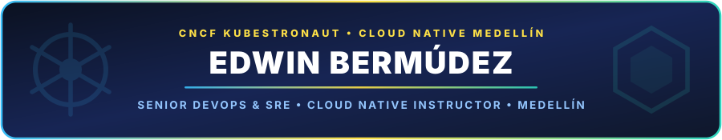

 

---

## 🚀 Sobre mí

Soy **Senior DevOps & Site Reliability Engineer (SRE)** apasionado por el ecosistema **Cloud Native**, la seguridad en contenedores, la automatización de infraestructura, la observabilidad avanzada y la educación abierta en tecnología.

- 👨‍🚀 **Kubestronaut (CNCF):** Distinción otorgada por la Cloud Native Computing Foundation por aprobar todas las certificaciones oficiales de Kubernetes (**CKA, CKS, CKAD, KCSA y KCNA**).
- 👨‍🏫 **Instructor y Mentor en Cloud Native Medellín:** Creador del programa práctico [**De Cero a Capitán en Kubernetes**](https://github.com/edwinbermudez91/Fundamentos-Kubernetes) (+48 participantes), con laboratorios en [**iximiuz Labs**](https://labs.iximiuz.com/trainings/fundamentos-de-docker-y-kubernetes-2ae16ea8/), [**Simulador KubeCafé**](https://edwinbermudez91.github.io/Fundamentos-Kubernetes/recursos/simulador-interactivo-kubernetes.html), retos de troubleshooting (*Retos Rotos*) y portafolios verificados.
- 🔭 **Especialidad Técnica:** Diseño, operación y endurecimiento (*hardening*) de clústeres **Kubernetes**, **Seguridad Cloud Native**, **Redes con Cilium (eBPF) & Gateway API**, **Observabilidad Full-Stack** (Prometheus, Grafana, OpenTelemetry) y **GitOps / CI/CD**.
- 🤝 **Misión en la Comunidad:** Democratizar el aprendizaje de infraestructura moderna en español, conectando la teoría con escenarios reales de producción.

---

## 🛠️ Stack Tecnológico & Ecosistema Cloud Native

### ☸️ Contenedores, Orquestación, Redes y Seguridad (CNCF)

### 📊 Observabilidad, SRE & GitOps / CI-CD

### ☁️ Infraestructura como Código, Cloud & Sistemas

---

## 🌟 Proyectos y Laboratorios Destacados

<table width="100%">
  <tr>
    <td width="50%" valign="top">
      <h3>🚢 <a href="https://github.com/edwinbermudez91/Fundamentos-Kubernetes">Fundamentos-Kubernetes</a></h3>
      
<b>Workshop práctico de 6 semanas: "De Cero a Capitán en Kubernetes"</b> para Cloud Native Medellín. Incluye arquitectura, Pods, Deployments, Services, <i>Retos Rotos</i> de troubleshooting, <a href="https://edwinbermudez91.github.io/Fundamentos-Kubernetes/recursos/simulador-interactivo-kubernetes.html">Simulador KubeCafé</a>, <a href="https://labs.iximiuz.com/trainings/fundamentos-de-docker-y-kubernetes-2ae16ea8/">labs en iximiuz</a> y <a href="https://github.com/edwinbermudez91/Fundamentos-Kubernetes/blob/main/ASISTENTES.md">ranking de portafolios</a>.

      

        
        
        
      

    </td>
    <td width="50%" valign="top">
      <h3>🛡️ <a href="https://github.com/edwinbermudez91/blindando-kubernetes">blindando-kubernetes</a></h3>
      
<b>Seguridad, Hardening y Buenas Prácticas en Kubernetes.</b> Laboratorios y guías prácticas para blindar clústeres y cargas de trabajo: seguridad en contenedores, control de accesos (RBAC), políticas de red, aislamiento y mitigación de vulnerabilidades en entornos Cloud Native.

      

        
        
        
      

    </td>
  </tr>
  <tr>
    <td width="50%" valign="top">
      <h3>📊 <a href="https://github.com/edwinbermudez91/labs-observabilidad">labs-observabilidad</a></h3>
      
<b>Laboratorios prácticos de Observabilidad y Redes Cloud Native.</b> Implementación paso a paso de stacks de monitoreo y networking moderno utilizando <b>Kubernetes, Prometheus, Grafana, Cilium y Gateway API</b>.

      

        
        
      

    </td>
    <td width="50%" valign="top">
      <h3>🧭 <a href="https://github.com/edwinbermudez91/devops">devops</a></h3>
      
<b>Repositorio de Ingeniería de Plataformas, SRE y Certificaciones.</b> Colección de guías prácticas, comandos esenciales, automatización y recursos de preparación para certificaciones como <b>CKA (Certified Kubernetes Administrator)</b>.

      

        
        
      

    </td>
  </tr>
</table>

---

## 📜 Certificaciones & Credenciales Oficiales

### 👨‍🚀 Kubestronaut, Kubernetes & Linux Foundation (CNCF / LF)
> Reconocimiento oficial de la CNCF por completar las 5 certificaciones de Kubernetes (**CKA, CKS, CKAD, KCSA y KCNA**), junto a **Istio (ICA)** y **Linux (LFCS)**.

<table>
  <tr>
    <td align="center" width="25%">
      <a href="https://www.credly.com/users/edwin-harley-bermudez-cuervo/badges" target="_blank">
         
        <b>Kubestronaut</b>
      </a>
    </td>
    <td align="center" width="25%">
      <a href="https://www.credly.com/users/edwin-harley-bermudez-cuervo/badges" target="_blank">
         
        <b>CKA</b>
      </a>
    </td>
    <td align="center" width="25%">
      <a href="https://www.credly.com/users/edwin-harley-bermudez-cuervo/badges" target="_blank">
         
        <b>CKS</b>
      </a>
    </td>
    <td align="center" width="25%">
      <a href="https://www.credly.com/users/edwin-harley-bermudez-cuervo/badges" target="_blank">
         
        <b>CKAD</b>
      </a>
    </td>
  </tr>
  <tr>
    <td align="center" width="25%">
      <a href="https://www.credly.com/users/edwin-harley-bermudez-cuervo/badges" target="_blank">
         
        <b>KCSA</b>
      </a>
    </td>
    <td align="center" width="25%">
      <a href="https://www.credly.com/users/edwin-harley-bermudez-cuervo/badges" target="_blank">
         
        <b>KCNA</b>
      </a>
    </td>
    <td align="center" width="25%">
      <a href="https://www.credly.com/users/edwin-harley-bermudez-cuervo/badges" target="_blank">
         
        <b>ICA (Istio)</b>
      </a>
    </td>
    <td align="center" width="25%">
      <a href="https://www.credly.com/users/edwin-harley-bermudez-cuervo/badges" target="_blank">
         
        <b>LFCS</b>
      </a>
    </td>
  </tr>
</table>

🏅 <b>Ver +14 certificaciones adicionales (Linux, AWS, GCP, Azure, GitHub y Cilium eBPF)</b>

 

#### 🐧 Administración de Sistemas & Linux
<table>
  <tr>
    <td align="center" width="33%">
      <a href="https://www.credly.com/users/edwin-harley-bermudez-cuervo/badges" target="_blank">
         
        <b>LFCA</b>
      </a>
    </td>
    <td align="center" width="33%">
      <a href="https://www.credly.com/users/edwin-harley-bermudez-cuervo/badges" target="_blank">
         
        <b>Red Hat I</b>
      </a>
    </td>
    <td align="center" width="33%">
      <a href="https://www.credly.com/users/edwin-harley-bermudez-cuervo/badges" target="_blank">
         
        <b>Red Hat II</b>
      </a>
    </td>
  </tr>
</table>

#### ☁️ Cloud Providers, DevOps & CI/CD
<table>
  <tr>
    <td align="center" width="16%">
      <a href="https://www.credly.com/users/edwin-harley-bermudez-cuervo/badges" target="_blank">
         
        <b>GCP ACE</b>
      </a>
    </td>
    <td align="center" width="16%">
      <a href="https://www.credly.com/users/edwin-harley-bermudez-cuervo/badges" target="_blank">
         
        <b>AWS SAA</b>
      </a>
    </td>
    <td align="center" width="16%">
      <a href="https://www.credly.com/users/edwin-harley-bermudez-cuervo/badges" target="_blank">
         
        <b>AWS CP</b>
      </a>
    </td>
    <td align="center" width="16%">
      <a href="https://www.credly.com/users/edwin-harley-bermudez-cuervo/badges" target="_blank">
         
        <b>Azure AZ-900</b>
      </a>
    </td>
    <td align="center" width="16%">
      <a href="https://www.credly.com/users/edwin-harley-bermudez-cuervo/badges" target="_blank">
         
        <b>GH Actions</b>
      </a>
    </td>
    <td align="center" width="16%">
      <a href="https://www.credly.com/users/edwin-harley-bermudez-cuervo/badges" target="_blank">
         
        <b>GH Foundations</b>
      </a>
    </td>
  </tr>
</table>

#### 🐝 Redes Cloud Native & eBPF (Isovalent / Cilium)
<table>
  <tr>
    <td align="center" width="20%">
      <a href="https://www.credly.com/users/edwin-harley-bermudez-cuervo/badges" target="_blank">
         
        <b>Gateway API</b>
      </a>
    </td>
    <td align="center" width="20%">
      <a href="https://www.credly.com/users/edwin-harley-bermudez-cuervo/badges" target="_blank">
         
        <b>Egress GW</b>
      </a>
    </td>
    <td align="center" width="20%">
      <a href="https://www.credly.com/users/edwin-harley-bermudez-cuervo/badges" target="_blank">
         
        <b>cert-manager</b>
      </a>
    </td>
    <td align="center" width="20%">
      <a href="https://www.credly.com/users/edwin-harley-bermudez-cuervo/badges" target="_blank">
         
        <b>LB-IPAM &amp; L2</b>
      </a>
    </td>
    <td align="center" width="20%">
      <a href="https://www.credly.com/users/edwin-harley-bermudez-cuervo/badges" target="_blank">
         
        <b>BGP on Cilium</b>
      </a>
    </td>
  </tr>
</table>

  <i>👉 Puedes consultar y verificar todas las credenciales e insignias en mi <a href="https://www.credly.com/users/edwin-harley-bermudez-cuervo/">Perfil Oficial de Credly</a>.</i>

---

## 🎙️ Workshops, Comunidad & Recursos Abiertos

- 🏔️ **Capítulo Oficial CNCF:** [Cloud Native Medellín (CNCF Community Groups)](https://ocgroups.dev/cncf/group/2majk4r)
- 🎮 **Simulador Visual Interactivo:** [KubeCafé Labs en GitHub Pages](https://edwinbermudez91.github.io/Fundamentos-Kubernetes/recursos/simulador-interactivo-kubernetes.html)
- 🧪 **Entorno Práctico Online:** [Training en iximiuz Labs (sin instalación local)](https://labs.iximiuz.com/trainings/fundamentos-de-docker-y-kubernetes-2ae16ea8/)
- 📺 **Grabaciones & Charlas:** [YouTube @CloudNativeColombia](https://www.youtube.com/@CloudNativeColombia)

---

## 📊 Métricas & Actividad en GitHub

  
  

---

## 🤝 Comunidad & Mentoría

¿Quieres aprender **Kubernetes, Seguridad Cloud Native, SRE y Observabilidad** con laboratorios reales o colaborar en eventos y talleres?

⚡ <i>"En la comunidad aprendemos haciendo, rompiendo clústeres y arreglándolos juntos."</i> — Cloud Native Medellín 🏔️☕

